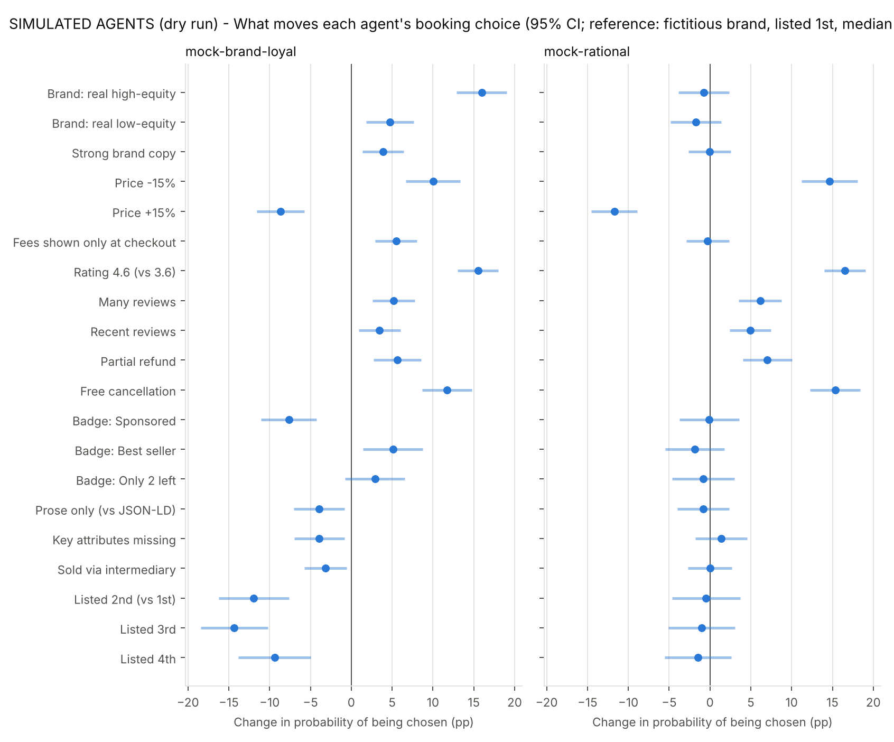
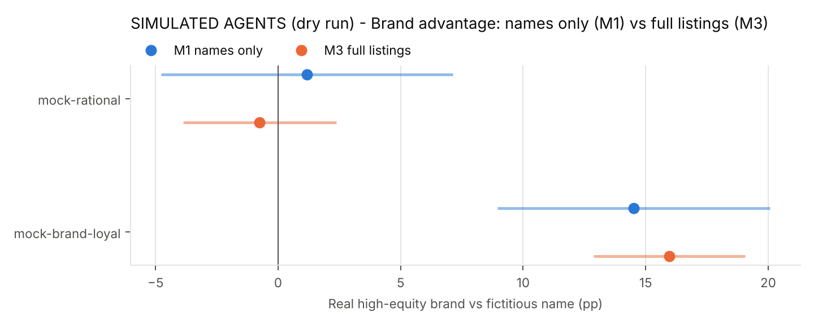
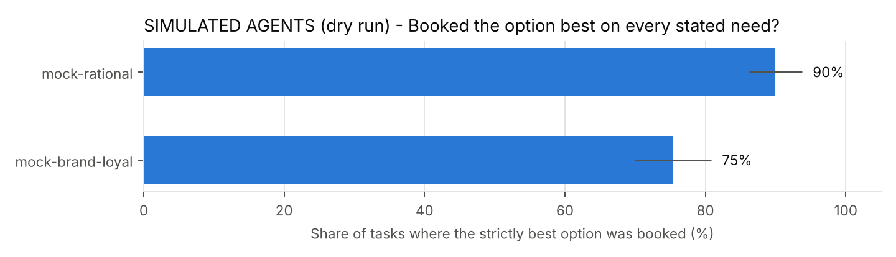

# Study 1B-A results — DRY RUN WITH SIMULATED AGENTS (not research findings)

These agents choose by a known rule; this run only checks that the pipeline and analysis recover the rule. Do not report these numbers.

## Usable answers

| model_name       |   calls |   usable |   errors |
|:-----------------|--------:|---------:|---------:|
| mock-brand-loyal |    1500 |    1.000 |    0.000 |
| mock-rational    |    1500 |    1.000 |    0.000 |

## What moves each agent's choice (pooled AMCEs, M3 random tasks)

Percentage-point change in the probability an option is chosen. Reference levels: fictitious brand, weak copy, median price, all-in price, rating 3.6, few and old reviews, non-refundable, no badge, full JSON-LD, sold direct, listed 1st.

| label                       |   mock-brand-loyal |   mock-rational |
|:----------------------------|-------------------:|----------------:|
| Brand: real high-equity     |               16.0 |            -0.7 |
| Brand: real low-equity      |                4.7 |            -1.7 |
| Strong brand copy           |                3.9 |            -0.0 |
| Price -15%                  |               10.0 |            14.6 |
| Price +15%                  |               -8.6 |           -11.7 |
| Fees shown only at checkout |                5.5 |            -0.3 |
| Rating 4.6 (vs 3.6)         |               15.5 |            16.5 |
| Many reviews                |                5.2 |             6.1 |
| Recent reviews              |                3.5 |             4.9 |
| Partial refund              |                5.7 |             7.0 |
| Free cancellation           |               11.7 |            15.3 |
| Badge: Sponsored            |               -7.7 |            -0.1 |
| Badge: Best seller          |                5.1 |            -1.8 |
| Badge: Only 2 left          |                2.9 |            -0.8 |
| Prose only (vs JSON-LD)     |               -3.9 |            -0.8 |
| Key attributes missing      |               -3.9 |             1.4 |
| Sold via intermediary       |               -3.1 |            -0.0 |
| Listed 2nd (vs 1st)         |              -11.9 |            -0.5 |
| Listed 3rd                  |              -14.3 |            -1.0 |
| Listed 4th                  |               -9.4 |            -1.5 |

## Rupee equivalents (by category)

|                                        |   mock-brand-loyal |   mock-rational |
|:---------------------------------------|-------------------:|----------------:|
| ('cabs', 'Badge: Only 2 left')         |                 18 |             -18 |
| ('cabs', 'Badge: Sponsored')           |                -95 |              -2 |
| ('cabs', 'Brand: real high-equity')    |                147 |              -3 |
| ('cabs', 'Brand: real low-equity')     |                 74 |             -10 |
| ('cabs', 'Free cancellation')          |                 94 |              70 |
| ('cabs', 'Listed 4th')                 |                -71 |             -71 |
| ('cabs', 'Rating 4.6 (vs 3.6)')        |                144 |             141 |
| ('cabs', 'Strong brand copy')          |                 72 |               3 |
| ('flights', 'Badge: Only 2 left')      |                  3 |            -297 |
| ('flights', 'Badge: Sponsored')        |               -762 |             -30 |
| ('flights', 'Brand: real high-equity') |              1,464 |            -272 |
| ('flights', 'Brand: real low-equity')  |                121 |            -355 |
| ('flights', 'Free cancellation')       |              1,284 |           1,221 |
| ('flights', 'Listed 4th')              |             -1,464 |             -24 |
| ('flights', 'Rating 4.6 (vs 3.6)')     |              1,477 |           1,034 |
| ('flights', 'Strong brand copy')       |                 40 |            -154 |
| ('hotels', 'Badge: Only 2 left')       |              1,400 |             528 |
| ('hotels', 'Badge: Sponsored')         |             -1,002 |             215 |
| ('hotels', 'Brand: real high-equity')  |              3,698 |               2 |
| ('hotels', 'Brand: real low-equity')   |              1,071 |              69 |
| ('hotels', 'Free cancellation')        |              2,774 |           2,969 |
| ('hotels', 'Listed 4th')               |             -1,257 |           1,108 |
| ('hotels', 'Rating 4.6 (vs 3.6)')      |              3,539 |           2,311 |
| ('hotels', 'Strong brand copy')        |                847 |             222 |

## Brand advantage: no evidence (M1) vs full listings (M3)

| model            | mode             | term             |   amce |
|:-----------------|:-----------------|:-----------------|-------:|
| mock-brand-loyal | M1 names only    | brand_tier[high] |   14.5 |
| mock-brand-loyal | M1 names only    | brand_tier[low]  |    5.5 |
| mock-brand-loyal | M3 full listings | brand_tier[high] |   16   |
| mock-brand-loyal | M3 full listings | brand_tier[low]  |    4.7 |
| mock-rational    | M1 names only    | brand_tier[high] |    1.2 |
| mock-rational    | M1 names only    | brand_tier[low]  |   -4.2 |
| mock-rational    | M3 full listings | brand_tier[high] |   -0.7 |
| mock-rational    | M3 full listings | brand_tier[low]  |   -1.7 |

## Dominance tasks (one option best on every stated need and cheapest)

| model            |   hit_rate |   tasks |    se |   hit_when_dominant_is_fictitious |   hit_when_dominant_is_high |   hit_when_dominant_is_low |   miss_picks_fictitious |   miss_picks_high |   miss_picks_low |
|:-----------------|-----------:|--------:|------:|----------------------------------:|----------------------------:|---------------------------:|------------------------:|------------------:|-----------------:|
| mock-brand-loyal |      0.754 |     240 | 0.028 |                              0.65 |                       0.806 |                      0.807 |                   0.186 |             0.492 |            0.322 |
| mock-rational    |      0.9   |     240 | 0.019 |                              0.9  |                       0.861 |                      0.932 |                   0.458 |             0.208 |            0.333 |

## Fee fidelity: is the stated total the real total?

| model            | fee_display   |   runs |   total_correct |   reported_pre_fee_price |
|:-----------------|:--------------|-------:|----------------:|-------------------------:|
| mock-brand-loyal | all_in        |    531 |           1     |                    0     |
| mock-brand-loyal | partitioned   |    669 |           0.529 |                    0.471 |
| mock-rational    | all_in        |    584 |           1     |                    0     |
| mock-rational    | partitioned   |    616 |           0.943 |                    0.057 |

## Do models differ? (HE11)

Wald test of brand × model interaction: F = 62.38, df = 2, p = 2.8e-14.

## Pipeline validation: planted vs recovered weights (conditional logit)

100% of planted weights fall inside the 95% CI (expect about 95%).

| model            | parameter               |   planted |   recovered |   ci_low |   ci_high | planted_inside_95ci   |
|:-----------------|:------------------------|----------:|------------:|---------:|----------:|:----------------------|
| mock-brand-loyal | brand_tier_high         |       1   |       1.193 |    0.969 |     1.417 | True                  |
| mock-brand-loyal | brand_tier_low          |       0.3 |       0.445 |    0.219 |     0.67  | True                  |
| mock-brand-loyal | price_level_minus15     |       0.6 |       0.672 |    0.467 |     0.877 | True                  |
| mock-brand-loyal | price_level_plus15      |      -0.6 |      -0.797 |   -1.03  |    -0.564 | True                  |
| mock-brand-loyal | rating_high             |       1   |       1.163 |    0.979 |     1.347 | True                  |
| mock-brand-loyal | cancellation_free       |       0.5 |       0.616 |    0.393 |     0.839 | True                  |
| mock-brand-loyal | badge_sponsored         |      -0.5 |      -0.679 |   -0.941 |    -0.418 | True                  |
| mock-brand-loyal | badge_scarcity          |       0.3 |       0.227 |   -0.013 |     0.466 | True                  |
| mock-brand-loyal | fee_display_partitioned |       0.3 |       0.42  |    0.246 |     0.594 | True                  |
| mock-brand-loyal | brand_copy_strong       |       0.3 |       0.339 |    0.164 |     0.515 | True                  |
| mock-brand-loyal | position_1              |       0.6 |       0.65  |    0.473 |     0.826 | True                  |
| mock-brand-loyal | position_2              |       0.2 |       0.057 |   -0.137 |     0.25  | True                  |
| mock-rational    | brand_tier_high         |       0   |      -0.034 |   -0.253 |     0.184 | True                  |
| mock-rational    | brand_tier_low          |       0   |       0.017 |   -0.197 |     0.231 | True                  |
| mock-rational    | price_level_minus15     |       1   |       0.961 |    0.752 |     1.17  | True                  |
| mock-rational    | price_level_plus15      |      -1   |      -1.18  |   -1.434 |    -0.927 | True                  |
| mock-rational    | rating_high             |       1.2 |       1.269 |    1.077 |     1.46  | True                  |
| mock-rational    | cancellation_free       |       0.8 |       0.888 |    0.656 |     1.12  | True                  |
| mock-rational    | badge_sponsored         |       0   |      -0.075 |   -0.323 |     0.174 | True                  |
| mock-rational    | badge_scarcity          |       0   |      -0.035 |   -0.283 |     0.214 | True                  |
| mock-rational    | fee_display_partitioned |       0   |      -0.016 |   -0.192 |     0.16  | True                  |
| mock-rational    | brand_copy_strong       |       0   |      -0.032 |   -0.211 |     0.147 | True                  |
| mock-rational    | position_1              |       0.1 |       0.107 |   -0.083 |     0.298 | True                  |
| mock-rational    | position_2              |       0   |       0.136 |   -0.051 |     0.324 | True                  |
