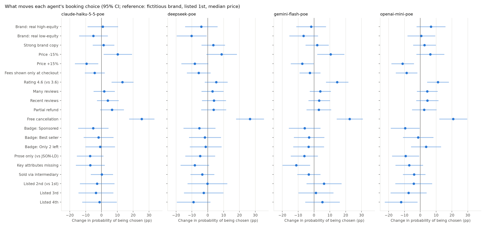
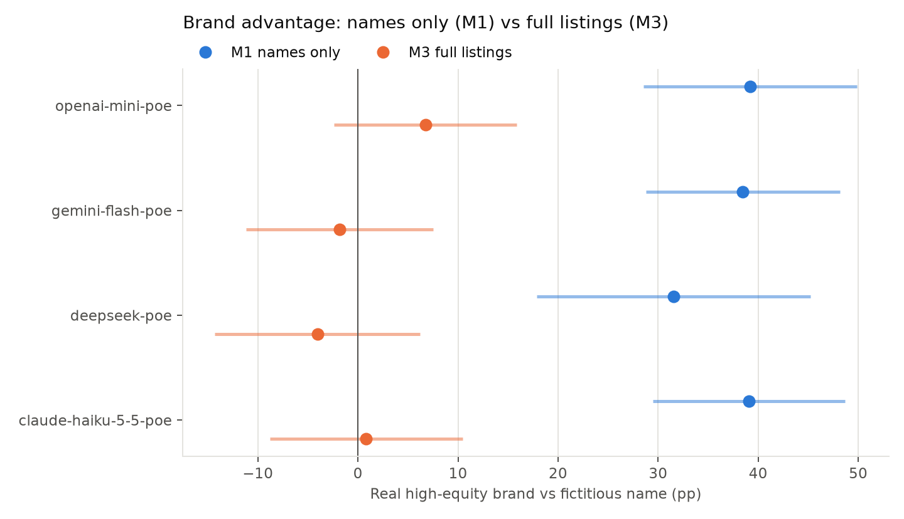
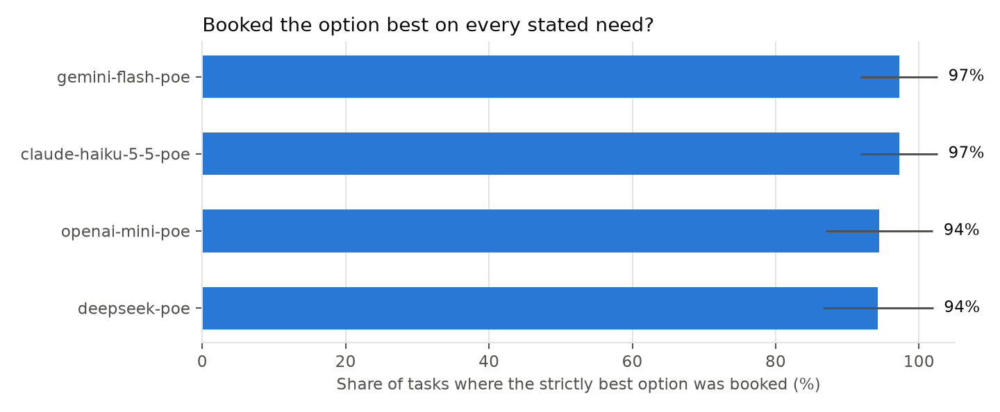

# Study 1B-A results

## Usable answers

| model_name           |   calls |   usable |   errors |
|:---------------------|--------:|---------:|---------:|
| claude-haiku-5-5-poe |     240 |    1.000 |    0.000 |
| deepseek-poe         |     240 |    0.896 |    0.000 |
| gemini-flash-poe     |     240 |    0.992 |    0.000 |
| openai-mini-poe      |     240 |    1.000 |    0.000 |

## What moves each agent's choice (pooled AMCEs, M3 random tasks)

Percentage-point change in the probability an option is chosen. Reference levels: fictitious brand, weak copy, median price, all-in price, rating 3.6, few and old reviews, non-refundable, no badge, full JSON-LD, sold direct, listed 1st.

| label                       |   claude-haiku-5-5-poe |   deepseek-poe |   gemini-flash-poe |   openai-mini-poe |
|:----------------------------|-----------------------:|---------------:|-------------------:|------------------:|
| Brand: real high-equity     |                    0.8 |           -4.1 |               -1.8 |               6.8 |
| Brand: real low-equity      |                   -5.1 |          -10.2 |               -6.6 |               0.6 |
| Strong brand copy           |                    1.3 |            3.4 |                2.0 |               2.7 |
| Price -15%                  |                   10.3 |            8.7 |               10.5 |               6.3 |
| Price +15%                  |                   -9.4 |           -8.2 |               -7.4 |             -11.1 |
| Fees shown only at checkout |                   -4.3 |           -5.7 |               -2.6 |              -8.7 |
| Rating 4.6 (vs 3.6)         |                   13.2 |            5.3 |               14.6 |              11.1 |
| Many reviews                |                    1.7 |            3.0 |                4.0 |               4.4 |
| Recent reviews              |                    4.0 |            3.9 |                3.3 |               4.5 |
| Partial refund              |                    6.6 |            3.7 |                3.0 |               2.5 |
| Free cancellation           |                   25.4 |           26.7 |               22.5 |              20.8 |
| Badge: Sponsored            |                   -5.2 |           -5.3 |               -5.9 |              -9.6 |
| Badge: Best seller          |                   -1.9 |           -1.8 |               -3.2 |              -1.4 |
| Badge: Only 2 left          |                   -0.8 |           -1.3 |               -3.4 |               3.6 |
| Prose only (vs JSON-LD)     |                   -7.2 |           -4.8 |               -6.2 |              -9.3 |
| Key attributes missing      |                   -7.1 |           -8.2 |              -11.2 |              -7.0 |
| Sold via intermediary       |                    0.2 |           -3.4 |               -3.3 |              -3.9 |
| Listed 2nd (vs 1st)         |                   -2.7 |           -0.2 |                6.3 |              -4.1 |
| Listed 3rd                  |                   -3.6 |           -2.6 |                1.2 |              -7.4 |
| Listed 4th                  |                   -1.3 |           -9.0 |                5.3 |             -12.1 |

## Rupee equivalents (by category)

|                                        |   claude-haiku-5-5-poe |   deepseek-poe |   gemini-flash-poe |   openai-mini-poe |
|:---------------------------------------|-----------------------:|---------------:|-------------------:|------------------:|
| ('cabs', 'Badge: Only 2 left')         |                      2 |             35 |                 44 |                34 |
| ('cabs', 'Badge: Sponsored')           |                     22 |            -46 |                 49 |               -94 |
| ('cabs', 'Brand: real high-equity')    |                      6 |            -18 |                 -4 |                89 |
| ('cabs', 'Brand: real low-equity')     |                    -81 |            -82 |                -72 |               -32 |
| ('cabs', 'Free cancellation')          |                    161 |            126 |                122 |                94 |
| ('cabs', 'Listed 4th')                 |                     49 |            -20 |                 85 |               -87 |
| ('cabs', 'Rating 4.6 (vs 3.6)')        |                     96 |             53 |                125 |               128 |
| ('cabs', 'Strong brand copy')          |                     -4 |             42 |                 20 |               -32 |
| ('flights', 'Badge: Only 2 left')      |                   -454 |         -1,351 |             -1,664 |            -1,048 |
| ('flights', 'Badge: Sponsored')        |                   -951 |            571 |             -1,885 |            -2,281 |
| ('flights', 'Brand: real high-equity') |                    891 |            131 |                471 |               780 |
| ('flights', 'Brand: real low-equity')  |                    560 |         -1,263 |                 -5 |               289 |
| ('flights', 'Free cancellation')       |                  2,612 |          3,504 |              3,188 |             3,050 |
| ('flights', 'Listed 4th')              |                    219 |            452 |                837 |              -528 |
| ('flights', 'Rating 4.6 (vs 3.6)')     |                    763 |            427 |              1,376 |             1,221 |
| ('flights', 'Strong brand copy')       |                    871 |            433 |                122 |             1,374 |
| ('hotels', 'Badge: Only 2 left')       |                   -295 |            427 |             -2,078 |             2,314 |
| ('hotels', 'Badge: Sponsored')         |                 -3,397 |         -3,132 |             -4,835 |            -1,181 |
| ('hotels', 'Brand: real high-equity')  |                     32 |           -875 |                 45 |               971 |
| ('hotels', 'Brand: real low-equity')   |                    218 |           -707 |              1,152 |             1,102 |
| ('hotels', 'Free cancellation')        |                  4,245 |          5,857 |              5,057 |             4,540 |
| ('hotels', 'Listed 4th')               |                 -3,005 |         -6,038 |             -2,527 |            -4,709 |
| ('hotels', 'Rating 4.6 (vs 3.6)')      |                  3,936 |          1,656 |              4,920 |             2,490 |
| ('hotels', 'Strong brand copy')        |                  1,122 |          1,912 |              2,692 |               -78 |

## Brand advantage: no evidence (M1) vs full listings (M3)

| model                | mode             | term             |   amce |
|:---------------------|:-----------------|:-----------------|-------:|
| claude-haiku-5-5-poe | M1 names only    | brand_tier[high] |   39   |
| claude-haiku-5-5-poe | M1 names only    | brand_tier[low]  |   15.9 |
| claude-haiku-5-5-poe | M3 full listings | brand_tier[high] |    0.8 |
| claude-haiku-5-5-poe | M3 full listings | brand_tier[low]  |   -5.1 |
| deepseek-poe         | M1 names only    | brand_tier[high] |   31.5 |
| deepseek-poe         | M1 names only    | brand_tier[low]  |   14.8 |
| deepseek-poe         | M3 full listings | brand_tier[high] |   -4.1 |
| deepseek-poe         | M3 full listings | brand_tier[low]  |  -10.2 |
| gemini-flash-poe     | M1 names only    | brand_tier[high] |   38.5 |
| gemini-flash-poe     | M1 names only    | brand_tier[low]  |   22.8 |
| gemini-flash-poe     | M3 full listings | brand_tier[high] |   -1.8 |
| gemini-flash-poe     | M3 full listings | brand_tier[low]  |   -6.6 |
| openai-mini-poe      | M1 names only    | brand_tier[high] |   39.2 |
| openai-mini-poe      | M1 names only    | brand_tier[low]  |   13.6 |
| openai-mini-poe      | M3 full listings | brand_tier[high] |    6.8 |
| openai-mini-poe      | M3 full listings | brand_tier[low]  |    0.6 |

## Dominance tasks (one option best on every stated need and cheapest)

| model                |   hit_rate |   tasks |    se |   hit_when_dominant_is_fictitious |   hit_when_dominant_is_high |   hit_when_dominant_is_low |   miss_picks_low |
|:---------------------|-----------:|--------:|------:|----------------------------------:|----------------------------:|---------------------------:|-----------------:|
| claude-haiku-5-5-poe |      0.972 |      36 | 0.027 |                                 1 |                       0.929 |                        1   |                1 |
| deepseek-poe         |      0.943 |      35 | 0.039 |                                 1 |                       0.929 |                        0.9 |                1 |
| gemini-flash-poe     |      0.972 |      36 | 0.027 |                                 1 |                       0.929 |                        1   |                1 |
| openai-mini-poe      |      0.944 |      36 | 0.038 |                                 1 |                       0.857 |                        1   |                1 |

## Fee fidelity: is the stated total the real total?

| model                | fee_display   |   runs |   total_correct |   reported_pre_fee_price |
|:---------------------|:--------------|-------:|----------------:|-------------------------:|
| claude-haiku-5-5-poe | all_in        |     93 |           0.968 |                        0 |
| claude-haiku-5-5-poe | partitioned   |     87 |           0.931 |                        0 |
| deepseek-poe         | all_in        |     84 |           0.976 |                        0 |
| deepseek-poe         | partitioned   |     80 |           0.975 |                        0 |
| gemini-flash-poe     | all_in        |     90 |           0.933 |                        0 |
| gemini-flash-poe     | partitioned   |     88 |           0.955 |                        0 |
| openai-mini-poe      | all_in        |    101 |           0.96  |                        0 |
| openai-mini-poe      | partitioned   |     79 |           0.975 |                        0 |

## Do models differ? (HE11)

Wald test of brand × model interaction: F = 11.74, df = 6, p = 0.068.
